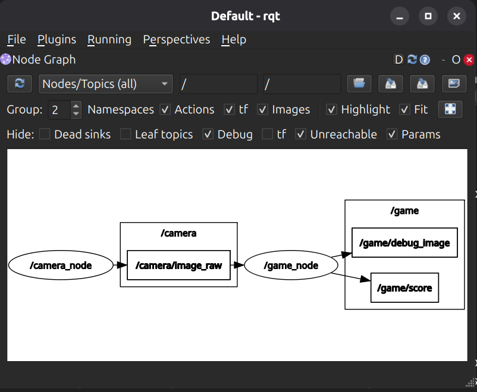

# Bouncing Ball Catcher

Game sederhana berbasis ROS 2 (Lyrical) dan OpenCV. Pemain menggerakkan tutup botol biru muda di depan webcam untuk menahan sebuah bola virtual selama 2 detik tanpa putus, lalu mendapat 1 skor. Setelah itu bola berpindah ke posisi acak.

Dibuat oleh: Muhammad Haqqi Nazili (5027261037)

## Persyaratan

- ROS 2 Lyrical (Ubuntu 26.04 / resolute)
- OpenCV
- `rqt_image_view` dan `ros2topic` (untuk mengecek topic dan melihat gambar)
- Webcam laptop

## Cara Menjalankan

### 1. Build

```bash
source /opt/ros/lyrical/setup.bash
cd ~/ros2_ws
colcon build --packages-select bouncing_ball_catcher
source install/setup.bash
```

### 2. Jalankan kedua node dengan satu launch file

```bash
ros2 launch bouncing_ball_catcher bouncing_ball.launch.py
```

Jendela `frame` (gambar beranotasi) dan `mask` (hasil segmentasi warna) akan muncul.

### 3. Melihat topic (opsional)

Di terminal lain:

```bash
source /opt/ros/lyrical/setup.bash
ros2 topic list
ros2 topic hz /camera/image_raw
ros2 topic echo /game/score
ros2 run rqt_image_view rqt_image_view
```

### Menjalankan node secara terpisah (alternatif)

Terminal 1:

```bash
ros2 run bouncing_ball_catcher camera_node --ros-args -p 'source:="0"'
```

Terminal 2:

```bash
ros2 run bouncing_ball_catcher game_node
```

## Arsitektur

Package ini berisi dua node:

- **camera_node** (`src/camera_node.cpp`): membaca webcam, membalik gambar secara horizontal, lalu mempublikasikannya sebagai `sensor_msgs/msg/Image` pada frame rate sesuai parameter `fps`. Untuk file video, node ini akan memutar ulang video dari awal ketika sudah habis.
- **game_node** (`src/game_node.cpp`): mensubscribe gambar, mendeteksi objek berwarna dengan HSV, menjalankan aturan game, lalu mempublikasikan skor dan gambar beranotasi.

Alur data:

```
camera_node → /camera/image_raw → game_node → /game/score
                                            → /game/debug_image
```

| Topic | Tipe pesan | Publisher | Subscriber | Keterangan |
| --- | --- | --- | --- | --- |
| /camera/image_raw | sensor_msgs/Image | camera_node | game_node | Frame mentah dari webcam |
| /game/score | std_msgs/Int32 | game_node | (opsional) | Skor saat ini, dipublikasikan setiap berubah |
| /game/debug_image | sensor_msgs/Image | game_node | rqt_image_view | Frame dengan bola, objek terdeteksi, dan skor |

## Parameter

Semua parameter ada di `config/params.yaml`. Parameter bisa diubah tanpa build ulang dengan cara menjalankan ulang launch file setelah mengedit YAML.

| Node | Parameter | Default | Fungsi |
| --- | --- | --- | --- |
| camera_node | source | "0" | Indeks webcam (`"0"`) atau path file video |
| camera_node | fps | 15.0 | Frame rate publikasi |
| camera_node | width | 640 | Lebar frame |
| camera_node | height | 480 | Tinggi frame |
| game_node | hsv_lower | [90, 50, 80] | Batas bawah HSV objek pemain |
| game_node | hsv_upper | [110, 255, 255] | Batas atas HSV objek pemain |
| game_node | min_area | 300 | Luas minimum kontur agar dianggap objek |
| game_node | num_balls | 3 | Jumlah bola virtual |
| game_node | ball_speed | 150.0 | Kecepatan bola (piksel per detik) |
| game_node | ball_radius | 40 | Radius bola (piksel) |
| game_node | hold_duration | 2.0 | Durasi tahan untuk mendapat skor (detik) |
| game_node | round_duration | 60.0 | Durasi satu ronde (detik) |

Cek nilai parameter yang sedang aktif (saat node berjalan):

```bash
ros2 param get /game_node hsv_lower
```

## Asumsi dan Keputusan Desain

- **Objek pemain**: tutup botol plastik berwarna biru muda. Warna ini dipilih karena kontras dengan sebagian besar latar ruangan.
- **Segmentasi warna**: piksel diubah dari BGR ke HSV, lalu dipilih dengan `cv::inRange` menggunakan rentang `hsv_lower` dan `hsv_upper`. HSV dipakai karena komponen warnanya (H) lebih stabil terhadap perubahan kecerahan dibanding BGR.
- **Pembersihan mask**: morphology `MORPH_OPEN` untuk menghapus bintik kecil, lalu `MORPH_CLOSE` untuk menutup lubang di dalam objek, dengan kernel ellipse 5x5.
- **Pemilihan objek**: dari semua kontur, diambil yang luasnya terbesar. Jika luasnya di bawah `min_area`, objek dianggap tidak terdeteksi.
- **Centroid**: dihitung dari momen kontur (`cv::moments`), yaitu m10/m00 dan m01/m00.
- **Waktu**: durasi tahan dihitung dari `header.stamp` yang dibawa setiap frame, bukan dari jumlah frame. Selisih waktu (`dt`) dijepit ke 0 sampai 0,2 detik supaya bola tidak melompat jauh jika kamera sempat macet.
- **Aturan bola bertumpuk**: jika centroid berada di dalam beberapa bola sekaligus, hanya bola dengan jarak centroid terdekat ke pusatnya yang dihitung.
- **Reset timer**: timer sebuah bola kembali ke 0 jika objek keluar dari bola atau objek tidak terdeteksi. Timer bola lain yang tidak dipilih juga di-reset.
- **Respawn**: saat skor tercapai, bola dipindah ke posisi acak dengan arah acak, dan timernya di-reset.
- **Gambar**: webcam dibalik horizontal supaya gerakan tangan ke kanan menggerakkan objek ke kanan di layar.
- **Visualisasi bola**: bola digambar transparan (`addWeighted`), supaya objek pemain di belakangnya tetap terlihat.

## Perjalanan Tiap Kendala dan Solusinya

- **`cv_bridge` tidak lengkap di instalasi apt ROS 2 Lyrical di sistem saya.** Header `cv_bridge/cv_bridge.h` dan `cv_bridge/cv_bridge_export.h` tidak ditemukan, walaupun paket sudah terpasang. Build dari source juga sempat gagal karena dependensi `ament_cmake_ros`. Solusinya, konversi antara `cv::Mat` dan `sensor_msgs/msg/Image` dilakukan manual di kode, dengan menyalin byte data, sehingga project tidak bergantung pada `cv_bridge`.
- **Build CMake gagal berulang kali**: beberapa penyebabnya adalah variabel `*_TARGETS` yang tidak dipakai di ament, pemanggilan `target_link_libraries` yang dicampur dua gaya (dengan dan tanpa kata kunci), serta environment ROS yang belum di-source di terminal. Diselesaikan dengan satu gaya pemanggilan untuk setiap target, variabel `*_INCLUDE_DIRS` dan `*_LIBRARIES`, dan selalu menjalankan `source /opt/ros/lyrical/setup.bash` sebelum build.
- **Parameter `source` ditolak sebagai integer**: ROS mendeklarasikan `source` sebagai string, sehingga `source:=0` gagal. Diselesaikan dengan menulis `source:="0"` (tanda kutip di dalam).
- **Perintah `ros2 topic`, `ros2 param`, dan `rqt_image_view` tidak tersedia** pada awalnya karena paket pendukungnya belum terpasang. Diselesaikan dengan `apt install` paket terkait.
- **Webcam hanya menghasilkan sekitar 15 fps**, walaupun `fps` diset 30. Mode MJPG sudah dicoba, tapi hasilnya tetap 15 Hz. Game tetap berjalan normal karena durasi dihitung dari timestamp, bukan jumlah frame.
- **Gambar webcam mirror** sehingga arah gerakan terbalik dan sulit dikontrol. Diselesaikan dengan `cv::flip` horizontal, yang bisa dimatikan lewat parameter `flip`.
- **Deteksi tidak penuh dan kadang bolong**: tutup botol plastik tipis tampak nerawang dan saturasi warnanya rendah, sehingga sebagian area tidak terdeteksi. Diatasi dengan menyesuaikan nilai HSV, memakai latar polos yang kontras, dan mengatur cahaya dari depan. Morphology juga membantu menutup sebagian lubang kecil.
- **Warna biru muda dan latar biru**: benda biru lain di belakang pemain bisa ikut terdeteksi. Solusinya adalah latar yang netral.

## Bonus

- **Mode ronde dengan batas waktu**: setiap ronde berlangsung `round_duration` detik (default 60 detik). Sisa waktu ditampilkan di pojok kanan atas, dan saat waktu habis game berhenti dan menampilkan skor. Tekan `R` untuk memulai ronde baru.
- **Tracking lebih halus**: centroid dihaluskan dengan exponential smoothing (`smoothing_alpha`), sehingga titik dan kotak pemain tidak bergetar. Smoothing direset saat objek tidak terdeteksi.
Fitur yang sudah ada (flip gambar lewat parameter, bar progres timer, dan bola transparan) termasuk dalam komponen wajib atau tampilan pendukung, bukan bonus dari daftar bagian 6.

## Demo

- Video demo (1 sampai 2 menit, termasuk momen skor naik): https://drive.google.com/file/d/1hE6NYdW9NTrjitQljQBXWvK8oZZ_7pK4/view?usp=drive_link
- Screenshot rqt_graph: `docs/rqt_graph.png`


